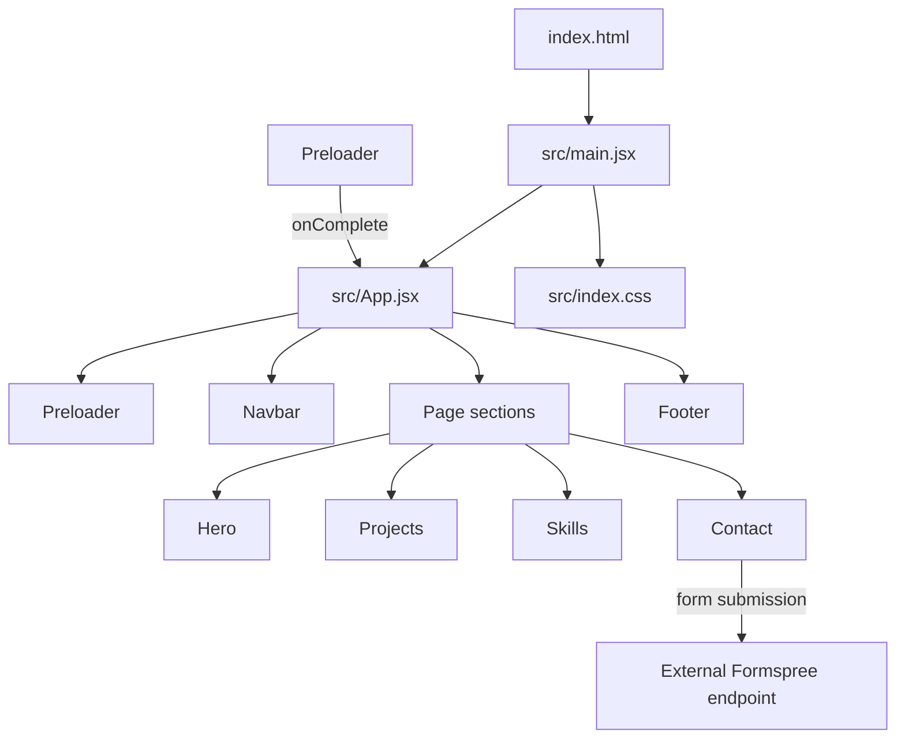

# Architecture

## Overview

This project is a single-page, client-rendered portfolio. Vite serves the React application during development and produces static files for deployment. There is no client-side router, application server, or central data store.



## Source layout

```text
index.html                   HTML document and React mount point
src/
  main.jsx                   React entry point; imports global CSS
  App.jsx                    Top-level composition and preloader state
  index.css                  Tailwind CSS entry point
  components/
    Navbar.jsx               Shared social navigation
    Preloader.jsx            Initial loading overlay and completion callback
  sections/
    Hero.jsx                 Introductory hero and résumé link
    Projects.jsx             Project showcase
    Skills.jsx               About/skills content
    Contact.jsx              Contact details and submission form
  hooks/
    anime-hooks.js           Animation hook collection; currently not imported
  assets/                    Images and other source-managed assets
public/
  MENDOZA_Resume.pdf         Public résumé, served from the site root
```

## Runtime and state flow

1. `index.html` provides the `#root` element. `src/main.jsx` imports the global stylesheet and renders `App` inside React `StrictMode`.
2. `App` owns the page-level `loading` state and initially renders the `Preloader` above the rest of the page.
3. `Preloader` runs its entrance, progress, and exit animations with Anime.js. When its exit finishes, it calls the `onComplete` callback supplied by `App`; `App` clears `loading` and unmounts the overlay.
4. The shared navigation, ordered page sections, and footer are composed by `App`. Each section owns its own presentation and any local interaction state.
5. `Contact` submits form data from the browser to the configured Formspree endpoint. This is the only documented external form integration; it is not an in-project backend.

There is no global state library or cross-section data flow. Keep state with the component that owns the interaction; lift it to `App` only when multiple parts of the page need to coordinate.

## Responsibilities and conventions

- **Application composition:** Add or reorder top-level page content in `src/App.jsx`. Keep the entry point focused on mounting the app and loading global CSS.
- **Reusable chrome:** Put site-wide elements such as navigation in `src/components/`.
- **Page content:** Keep major portfolio areas in `src/sections/`. A section should own its content and local interaction state.
- **Content and assets:** Project and skill content is currently authored in the section components. Imported source assets belong in `src/assets/`; files that need stable root URLs belong in `public/`.
- **Styling:** Tailwind CSS v4 is enabled through the Vite plugin; `src/index.css` is the Tailwind import point. Most component styles are expressed with utility classes.
- **Animation:** Anime.js and Framer Motion are both dependencies and are used directly by page components. `Preloader` uses Anime.js, while sections use animation libraries as needed. The separate `src/hooks/anime-hooks.js` collection is not currently imported by the application; treat it as dormant code rather than the active shared animation API.
- **Contact integration:** The contact form posts to a Formspree URL in `src/sections/Contact.jsx`. Update that integration deliberately if the form provider or endpoint changes.
- **Navigation:** This is a single document with section anchors, not a routed multi-page app.

## Extending the page

### Add a section

1. Create a component in `src/sections/`.
2. Keep section-specific state and behavior inside the component where possible.
3. Import and render it in `src/App.jsx` in the intended page order.
4. If it needs in-page navigation, give it a stable section `id` and connect the navigation link to that anchor.

### Add or update portfolio content

Edit the relevant section component and its imported assets. Put downloadable files that should be served directly from the site root in `public/` and reference them with a root-relative URL.

### Add a shared component

Place genuinely reused, site-wide UI in `src/components/`. Avoid adding a shared abstraction for markup that only has one clear use.

## Build and quality checks

Run `npm run lint` to check the JavaScript/JSX source and `npm run build` to verify the production bundle. Run the development server with `npm run dev`; `npm run preview` serves the already-built `dist/` output.

The package currently defines no automated test script. When adding test infrastructure, document the runner and add a script to `package.json`.
